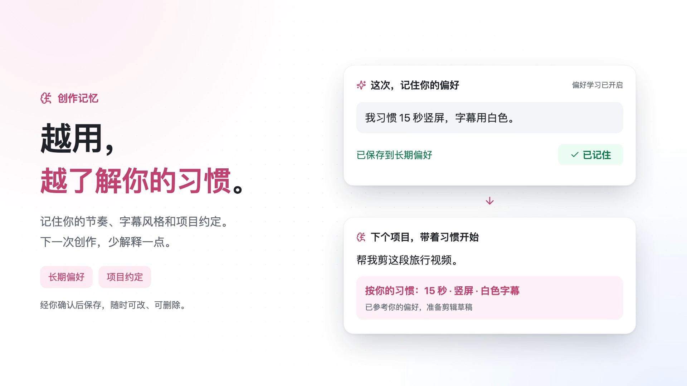

<p align="center"></p>
<h1 align="center">TadaCut</h1>
<p align="center"><strong>Say it. Make it.</strong></p>
<p align="center">An AI video studio on your computer. Turn ideas into stories, timelines, and videos with a conversation.</p>
<p align="center"><a href="README.zh-CN.md">简体中文</a> · <a href="#quick-start">Quick start</a> · <a href="#features">Features</a> · <a href="docs/third-party.md">Licensing</a></p>

https://github.com/user-attachments/assets/3fb94ead-1fb3-471c-b1a0-4ea5ab4beb8a

[Download the 58-second film](https://github.com/zheflow/TadaCut/raw/refs/heads/main/docs/media/TadaCut-promo.mp4) · 720p · 4.3 MB

TadaCut brings a multitrack editor, story studio, media library, and your choice of AI models into one local application. Its assistant stays beside every workspace page and receives your current page, selections, and referenced clips as context.

The application source is MIT-licensed. Rendering and bundled components have their own [license terms](docs/third-party.md), including Remotion. The current interface is primarily in Simplified Chinese.

## Features

- **Edit by conversation.** Work with clips, subtitles, stories, assets, models, skills, and settings. Review proposed changes and undo project edits.
- **Remember your creative habits.** Keep project conventions and long-term preferences. Enable preference learning to review suggested memories, then accept the ones you want to reuse. Search, edit, or delete them anytime.
- **Work with focused skills.** Discover and load workflows and tools as needed. Task plans, working notes, context budgets, compaction, and resumable conversations keep long edits manageable.
- **Use the timeline directly.** Trim, split, and move clips between compatible tracks; select and reference several assets at once.
- **Build a story.** Organize characters, locations, episodes, scenes, and shots. Synchronize storyboards and the editing timeline.
- **Edit the transcript.** Use word timestamps for text-based editing, filler cleanup, captions, and bilingual subtitles.
- **Create media.** Connect image, video, speech, music, and embedding providers. Add React motion graphics, effects, color adjustments, and audio analysis.
- **Choose your models.** Connect compatible APIs, Ollama, LM Studio, or installed external agent runtimes. Configure different providers for different tasks.
- **Go further.** Use speed curves, masks, motion tracking, RGB/HSL adjustments, subtitles and lyrics, proxies, camera recording, and your own team project and review service. See [advanced features and requirements](docs/advanced-features.md).
- **Keep control.** Credentials use a local encrypted vault. Set tool permissions; publishing requires confirmation. Desktop actions are scoped to a window session you start.
- **Export your work.** Save portable `.tadacut` projects, video, audio, SRT, Markdown, FCPXML, EDL, and supported draft formats.


## Quick start

Use **Node.js 22.22.0 or a newer Node 22 LTS release**, with npm 10. A `.nvmrc` is included.

```sh
git clone https://github.com/zheflow/TadaCut.git
cd TadaCut
npm ci
npm run dev
```

Open **http://127.0.0.1:4318**. The original “City Walk” sample project includes code-generated illustrations and music. To use AI, open **Models / 模型**, configure a provider, and select it in the assistant. Without a model, the labeled offline mode handles a small set of fixed editing commands; it is not general AI chat.

```sh
npm run desktop       # Build and launch the Electron app
npm run package:mac   # Build a macOS arm64 app and DMG on macOS
npm run package:win   # Build a Windows x64 installer on Windows
```

macOS packaging needs Xcode Command Line Tools and `make` to compile LGPL FFmpeg. The first package build downloads the rendering browser and FFmpeg source. Local macOS builds use an ad-hoc signature; public distribution needs appropriate signing and notarization. Windows packaging is configured but has not been validated on a Windows machine.

## Models, permissions, and privacy

The assistant uses the same validated operations as the interface. Its tools receive page changes and selected references, so you can say “tag these clips” without restating where you are.

Model quality and tool support depend on your chosen provider. Remote services receive the content needed for your requests. Credential entry, operating-system permissions, native file selection, and some downloads still need user interaction. See the [assistant guide](docs/assistant.md) and [availability notes](docs/reality-audit.md).

Desktop data lives in the platform's application-data directory under `TadaCut`; the browser host defaults to `~/.tadacut`. Project exports exclude stored credentials. Use `TADACUT_DATA_DIR` for an isolated directory, `TADACUT_PORT` for the API port, and `TADACUT_DESKTOP_PORT` for the desktop port. `TADACUT_FFMPEG_PATH`, `TADACUT_FFPROBE_PATH`, and `TADACUT_CHROME_PATH` override local media tools.

## Memory that stays under your control



TadaCut can remember preferences such as “15-second vertical videos with white subtitles” and recall relevant ones in later projects. Project conventions and global preferences are stored separately; your current request takes priority. Say “remember…” to save a preference explicitly, or enable optional preference learning and accept the suggestions you want to keep. Learning is off by default, and suggestions become durable memories only after your confirmation.

Use **Settings → Memory** to search, edit, and delete memories. **Manage context** in the assistant shows task plans, notes, loaded skills, and compaction controls. Starting a new conversation preserves saved preferences. See the [agent foundation guide](docs/agent-foundation.md) for the implementation and its limits.

## Development

```sh
npm run check
npm test
npm run format:check
npm run build
npm run test:ui
npm run test:shaders
```

Tests use isolated data and controlled provider fixtures. Browser and Electron checks exercise actual UI operations. See the [verification guide](docs/verification.md) for coverage and remaining gaps.

| Directory         | Purpose                                                            |
| ----------------- | ------------------------------------------------------------------ |
| `apps/studio`     | React editor and global assistant                                  |
| `apps/desktop`    | Electron host, credential encryption, capture, and desktop actions |
| `apps/server`     | Local API, persistence, agent tools, and jobs                      |
| `packages/domain` | Validated commands, timeline, story state, and undo                |
| `packages/render` | Remotion compositions, effects, and export                         |
| `promo`           | Reproducible film, illustrations, and synthesized score            |

## Reproduce the film

The 58-second master is **1920 × 1080 at 60 FPS**. The README uses a 4.3 MB, 720p/30 FPS copy for fast inline playback. Its animations, sample illustrations, and soundtrack are generated by the included code. The memory chapter shows a preference being accepted and recalled in the next project: “越用，越了解你的习惯” (“The more you use it, the better it understands your habits”). It illustrates workflows; the workspace screenshot above comes from the running app.

```sh
npm run promo                      # output/promo/TadaCut-promo.mp4 and cover.png
npm run promo -- --stills=450,900  # Inspect selected frames
npm run promo -- --audio           # Generate the soundtrack only
```

## Documentation

- [Architecture and data boundaries](docs/architecture.md)
- [Feature details and requirements](docs/features.md)
- [Assistant, references, and appearance](docs/assistant.md)
- [Skills, context, and memory](docs/agent-foundation.md)
- [Advanced editing and team features](docs/advanced-features.md)
- [Providers and custom routes](docs/providers.md)
- [Verification and limitations](docs/verification.md)
- [Contributing](CONTRIBUTING.md)
- [Third-party components and licenses](docs/third-party.md)

## License

TadaCut's own source code is released under the [MIT License](LICENSE). Dependencies, models, and bundled binaries retain their respective licenses. Remotion is source-available under its own license; larger commercial organizations may need a paid license. Read [third-party licensing](docs/third-party.md) before distributing builds.
