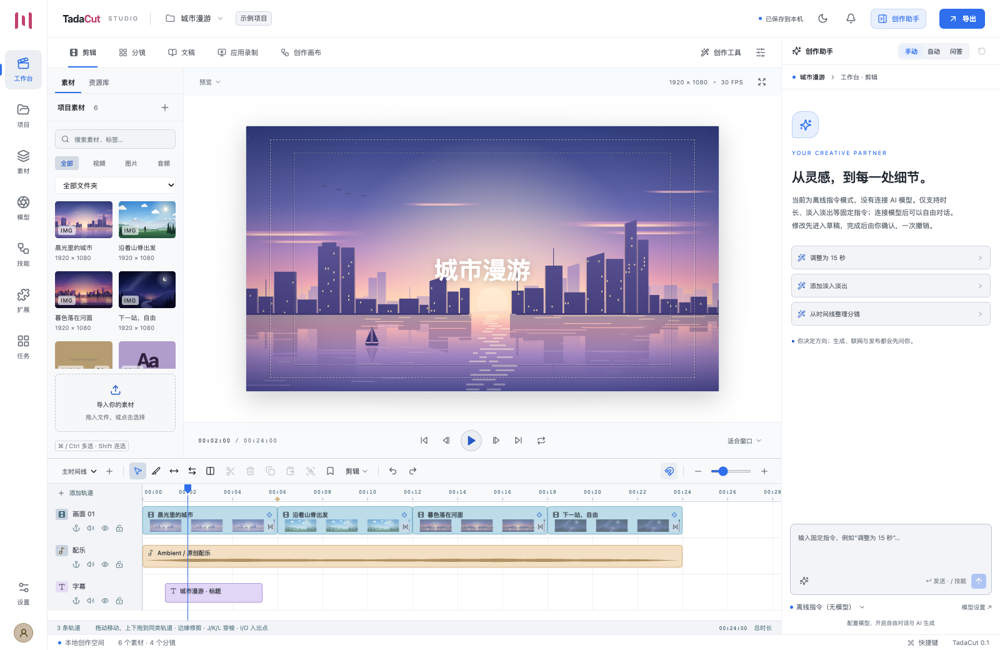

# TadaCut

**Say it. Make it. — 说出想法，剪出作品。**

[English](README.md) · [观看 50 秒宣传片](docs/media/TadaCut-promo.mp4)

[](docs/media/TadaCut-promo.mp4)

https://github.com/user-attachments/assets/009af342-d71d-4744-a1cf-25d2d80d0694

一个由 TypeScript 编写的本地视频创作工作室：把故事、素材、时间线、自选模型与应用录制放在同一个项目里。界面和业务代码共用于 macOS / Windows，桌面宿主使用 Electron。



## 打开应用

可以从源码构建 Mac 安装包，产物位于 `release/`。将 DMG 中的 TadaCut 拖入 Applications 即可。本机构建采用 ad-hoc 签名；公开分发时需要配置开发者签名与公证。

开发环境使用 Node **22.22.0** 或更新的 Node 22 LTS，以及 npm 10：

```sh
git clone https://github.com/zheflow/TadaCut.git
cd TadaCut
npm ci
npm run dev
```

浏览器工作台：`http://127.0.0.1:4318`。浏览器模式支持剪辑、本地模型、工程管理和模型 API；桌面应用操作通过 Electron 版本使用。

```sh
npm run desktop       # 构建并启动桌面程序
npm run package:mac   # 在 Mac 上生成 arm64 .app / .dmg
npm run package:win   # 在 Windows 上生成 x64 NSIS .exe
```

两个平台使用相同的 TypeScript 源码。Windows 安装任务已配置在 `.github/workflows/packages.yml`，只在手动触发时运行。本次验证范围为 Mac。

## 创作流程

右侧创作助手贯穿工作台、项目、素材、模型、技能、扩展、任务与设置。切换页面后可以直接描述需求，页面和多项引用会自动进入上下文；⌘ / Ctrl 多选，Shift 连选。默认是白色浅色外观：中性灰分层，蓝色标出可操作的重点，红色只用于错误；可切换深色，樱花装饰可在设置中打开。助手出错时会显示服务或运行时给出的原因。

1. 打开原创示例项目“城市漫游”，或者新建项目。导入素材、双击加入时间线、拖动移动，片段边缘修剪，`S` 分割，`Delete` 删除。
2. 在“模型”配置自己的 API 地址、密钥与模型；本地 Ollama / LM Studio 也使用这一入口。没有模型时，“离线指令（无模型）”通过固定规则处理时长、淡入淡出、竖屏与分镜整理，不提供通用 AI 对话。
3. 在“分镜”维护镜头、角色与场景；选择“采用分镜”或“采用剪辑”进行双向同步。联合修改可以一次撤销。
4. 在“文稿”使用本地 Whisper 或自配转写服务，按词剪辑、清理口癖、修正文本和生成字幕。字幕时间按实际剪辑、入点与速度映射。
5. 在“创作工具”使用图片、视频、配音、音色克隆、音乐、代码动画、声音分析、静音剪辑、多机位、语义索引和网页采集。
6. 在“应用录制”选择画面或录制旁白；桌面版可选择一个目标窗口开始应用操作会话。会话产生的点击记录可用于片段聚焦关键帧。
7. 在“素材库”复用素材、编辑代码动画、重连源文件、关联自动导入目录或按语义查找素材。在“任务”查看进度、分析结果、下载、取消与重试。
8. 导出完整 `.tadacut` 工程、SRT、Markdown、FCPXML、EDL 或含素材的 CapCut 草稿。视频支持 H.264 / H.265 / VP8 / VP9 / ProRes；音频支持 MP3 / WAV，WebM / ProRes 可保留透明通道。

## 模型与本机能力

密钥保存在宿主凭据库；桌面版优先使用系统凭据加密，浏览器宿主使用权限受限的 AES-GCM 本地库。每项凭据记录自己的加密方式，系统钥匙串在某次启动不可用时应用仍能打开，读不出的密钥会提示重新填写。公共接口只返回 `hasKey`（以及无法读取时的 `keyUnreadable`），工程包不包含密钥。

远端生成、视觉理解及云转写使用你选择的供应商。模型名称、可用能力、费用和配额以该服务为准。自定义 JSON 路由支持不同媒体服务；示例见 [供应商配置](docs/providers.md)。供应商不需要具备全部能力，可以分别配置聊天、图片、声音和 embedding。

Whisper、CLAP、DETR 为用户主动运行的本地模型，首次使用下载权重，后续使用浏览器缓存。Whisper 负责词级转写；CLAP 比较音频与候选描述；DETR 为竖屏重构生成主体位置关键帧。视觉检测和节拍算法的结果需要通过预览或试听判断。

录屏、麦克风与应用操作遵循操作系统权限。应用操作仅接受所选窗口会话内的点击、文字、有限按键和滚动；每次执行先激活并核对窗口。应用会话有效期 15 分钟，结束后拒绝后续操作。记录的点击来自应用会话动作。

Codex、Claude Code、Copilot 适配器沿用本机运行时与登录状态，在 App 中遵循相同的允许 / 询问 / 禁止策略；通用 MCP 连接为外部 Agent 提供项目读取与编辑提案。TypeScript 技能脚本需要本机 Deno，执行时限定项目素材读取与临时输出写入。

模型页可单独检测真实 Codex 的协议与认证，不发起推理；检测到 CLI 或 SDK 不等于模型可用。预置示例、规则算法、测试模拟和未完成真实服务验证的范围见 [功能真实性核查](docs/reality-audit.md)。

## 架构与验证

- [架构、数据边界与扩展方式](docs/architecture.md)
- [功能覆盖与实现边界](docs/features.md)
- [全局助手、工具范围与外观](docs/assistant.md)
- [本机验证记录](docs/verification.md)
- [供应商与自定义路由](docs/providers.md)
- [第三方组件与授权](docs/third-party.md)

```sh
npm run check
npm test
npm run build
node scripts/smoke-ui.mjs
```

验证使用原创示例素材、独立临时数据库和本机模拟模型服务。常规验证不生成成片、不调用付费模型，也不操作个人应用或媒体。

## 宣传片

`promo/` 是一支 50 秒的宣传片（1920 × 1080，60 FPS），画面、动画和配乐全部由代码生成：Remotion 组件呈现应用工作台界面；示例项目“城市漫游”的四个镜头（晨光城市、山脊、暮色河面、夜路）是 `promo/src/art.tsx` 中的分层 SVG 插画，应用内的示例素材也由同一份代码导出；配乐在 `promo/audio` 中逐个采样合成，画面与声音共用 `promo/src/timeline.ts` 的节拍表。

```sh
npm run promo                       # 输出 output/promo/TadaCut-promo.mp4 与 cover.png
npm run promo -- --stills=450,900   # 只渲染指定帧，用于检查排版
npm run promo -- --shots            # 四个示例镜头的总览与单张
npm run promo -- --audio            # 只生成配乐
npm run sample-art                  # 把四个镜头写入应用示例项目的素材
```

渲染优先使用 `build/render-browser` 中的 Chrome Headless Shell，不调用任何模型。

## 数据位置

桌面版：macOS 的 `~/Library/Application Support/TadaCut`；Windows 的用户应用数据目录下 `TadaCut`。浏览器宿主默认为 `~/.tadacut`。项目、历史、任务、对话、技能存入 SQLite，媒体与导出文件保存在相邻目录。

开发时可用 `TADACUT_DATA_DIR` 指定独立数据目录，`TADACUT_PORT` 修改浏览器宿主端口，`TADACUT_DESKTOP_PORT` 修改桌面端口。桌面默认使用本机端口 **4319**，外部 MCP 配置可以复用。`TADACUT_FFMPEG_PATH`、`TADACUT_FFPROBE_PATH` 和 `TADACUT_CHROME_PATH` 可以指定本机工具；FFmpeg / FFprobe 与渲染浏览器随安装包提供，macOS 版的 FFmpeg 由 `node scripts/build-ffmpeg.mjs` 从官方源码编译为 LGPL 版本。

## 授权

TadaCut 以 [MIT 授权](LICENSE) 发布。渲染依赖的 Remotion 使用自己的授权：个人和小团队免费，规模较大的公司需要购买许可；FFmpeg、渲染浏览器等随包组件见 [第三方组件与授权](docs/third-party.md)。
