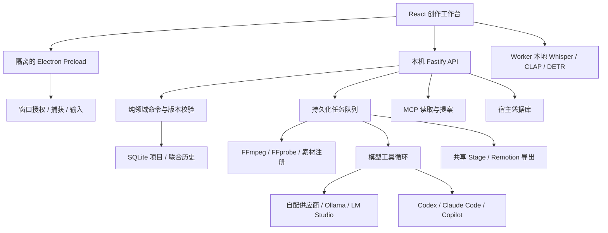

# 架构

应用代码统一使用 TypeScript。React 提供界面，Electron 封装本机能力，Fastify 提供只监听 loopback 的本地服务；领域模型与编辑规则可以脱离界面、宿主和模型独立测试。

## 目录职责

| 目录                          | 职责                                                               |
| ----------------------------- | ------------------------------------------------------------------ |
| `apps/studio/src/app`         | 应用外壳、导航、错误恢复                                           |
| `apps/studio/src/features`    | 时间线、预览、属性、分镜、文稿、画布、录制、模型、技能、任务       |
| `apps/studio/src/lib`         | API、串行编辑队列、UI 状态、本地模型桥接                           |
| `apps/studio/src/workers`     | 本地模型下载、推理与取消隔离                                       |
| `apps/server/src/server.ts`   | 路由、会话、来源限制、依赖组装                                     |
| `apps/server/src/storage.ts`  | SQLite、幂等事务、撤销重做、凭据库                                 |
| `apps/server/src/jobs.ts`     | 有界并发、进度、取消、重启后的 interrupted 状态                    |
| `apps/server/src/media.ts`    | 导入、哈希去重、探测、缩略图、音频处理                             |
| `apps/server/src/handlers.ts` | 媒体、分析、生成、渲染和应用操作任务                               |
| `apps/server/src/agent.ts`    | 项目工具、编辑提案、技能和会话持久化                               |
| `apps/server/src/external.ts` | 外部 Agent 协议适配                                                |
| `apps/server/src/mcp.ts`      | Streamable HTTP MCP，客户端显式提交项目版本                        |
| `apps/server/src/watchers.ts` | 用户选择目录的监控、导入和去重                                     |
| `apps/desktop/src`            | Electron 生命周期、IPC、原生窗口适配器                             |
| `packages/domain/src`         | Schema、命令、动画、信号分析、字幕映射和工程交换                   |
| `packages/providers/src`      | Responses / Chat Completions / Anthropic / Ollama / 媒体 HTTP 适配 |
| `packages/agent/src`          | 宿主无关的工具执行循环和上下文压缩                                 |
| `packages/render/src`         | 预览与导出共享的画面、效果和动画；纯 render plan                   |
| `packages/motion/src`         | 沙箱动画运行环境与原创模板                                         |
| `packages/platform/src`       | 类型化原生接口、动作校验和会话约束                                 |
| `scripts`                     | 开发、生产构建、图标、浏览器验证                                   |
| `tests`                       | 领域、接口、供应商和原生契约测试                                   |

## 编辑与历史

所有编辑采用 `Transaction {requestId, expectedRevision, label, commands}`。先在克隆上应用、检查引用与约束，再在一个 SQLite 事务中保存项目和联合历史。任何命令失败均不提交其余命令。

同一 requestId 只能重放相同载荷。撤销和重做均增加 revision，防止旧提案越过用户编辑。AI 提案绑定它实际读取的版本；用户确认时再次检查。MCP 修改工具要求客户端附带 `expectedRevision`。

分镜与剪辑分别记录同步基线。仅一侧变化可正常同步；双方修改时按用户选择的同步方向处理。分割和按词剪辑根据 sourceOffset、speed 与 fps 计算源位置，并保存边界动画值。

## 运行与权限边界

界面取得同源 HttpOnly 会话，写入检查来源和本机 Host。Cookie 不按端口隔离，因此只信任工作台自身来源；Vite 开发服务器的来源只在 `npm run dev` 通过 `TADACUT_DEV_ORIGINS` 显式加入。MCP 使用独立 Bearer 凭据。媒体渲染使用短期宿主令牌，模型工具目录不提供凭据、通用 shell 或任意路径读取。

凭据库的每一项都标明由系统凭据（Electron safeStorage）还是本机 AES-GCM 密钥文件加密。钥匙串的可用性可能在两次启动之间改变（拒绝授权、钥匙串锁定、重新签名的构建）；读不出的项目按缺失处理：MCP 凭据重新生成，供应商显示“凭据无法读取”并要求重新填写，应用照常启动。

桌面 Preload 使用 contextIsolation、sandbox 与关闭 Node integration。IPC 只接受当前工作台主 frame。原生操作在主进程排队，启动会话后仅操作选定窗口，并校验坐标、按键和有效期。nut-js 的窗口 handle shim 限定在一个适配文件，版本固定为 4.2.6。

代码动画在独立的 opaque-origin iframe 中编译，只有 React 与逐帧参数，没有宿主桥接。动画页面使用单独 CSP，主应用不开放普通 eval。渲染等待视频取样、WebGL 效果和动画 frame 完成。

技能 TypeScript 脚本由 Deno 子进程运行，没有网络、环境变量、FFI 或子进程权限，只授予本项目媒体读取与临时输出写入。脚本返回的 commands 仍通过提案校验。

## 任务与导出

关闭服务时先在 preClose 结束事件流，再强制关闭仍打开的连接（例如暂停读取的媒体流），然后停止监视器与任务。桌面版退出最多等待 5 秒，之后无论结果如何都会退出。

队列并发默认 2；控制信号贯穿 HTTP、浏览器、FFmpeg 和渲染。进程取消先 SIGTERM，再按需 SIGKILL。重启时不自动重发可能收费的任务，标记 interrupted 后由用户重试。

导出在入队时冻结项目快照，后续编辑不改变任务所用版本。浏览器和导出共用 Stage、时间/动画采样和 WebGL 效果。生成、归一、降噪和录制产生新素材，源素材保持可追溯。

## 构建决策

桌面初始化放在 `app.whenReady().then(...)` 内，避免 ESM 顶层 await 等待 ready 的循环。Preload 编译为 CJS，满足 Electron sandbox 的加载要求。[Electron ESM 文档](https://www.electronjs.org/docs/latest/tutorial/esm)

Remotion 资源在构建阶段预打包，安装后的渲染不依赖源码路径或 webpack 编译。原生依赖、工具和模型浏览器资源通过 electron-builder 的文件收集配置写入安装包。Mac DMG 与 Windows NSIS 共用入口和业务包，只有系统权限和原生依赖存在平台差异。

渲染浏览器固定到已验证的 Chrome Headless Shell 稳定版本（Remotion 的默认渲染模式），保留整个原生资源目录与相对符号链接。导出的视频帧由 OffthreadVideo 交给随包 FFmpeg 解码，不依赖浏览器的专有编解码器。浏览器下载和 ZIP 提取在构建阶段执行，安装后的运行不依赖下载缓存。
